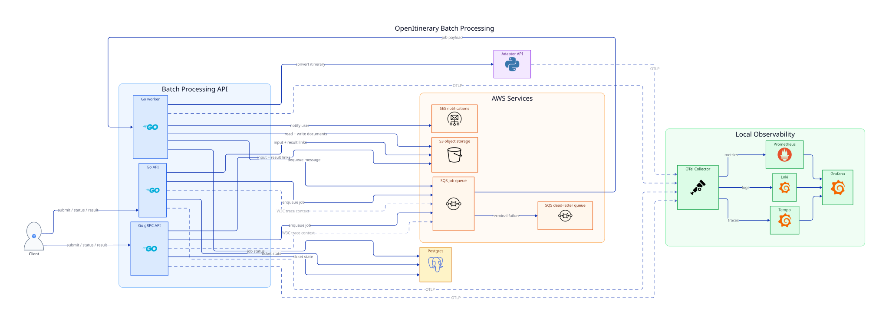

# OpenItinerary Batch Processing

[](https://github.com/kiran94/openitinerary-batch-processing/actions/workflows/build.yml) [](https://github.com/kiran94/openitinerary-batch-processing/actions/workflows/terraform.yml)

> The OpenItinerary Batch Processing (OIBP) service provides an asynchronous solution to converting traditional travel documents into the [OpenItinerary Standard](http://github.com/kiran94/openitinerary).

## Features

- Submit PDF, HTML, and RFC 822 email documents for asynchronous itinerary processing.
- Receive a processing ticket and track its status through the API.
- Convert submitted documents through the [OpenItinerary Adapter API](http://github.com/kiran94/openitinerary#adapter-api-configuration).
- Retrieve completed itineraries through temporary download links.
- Send completion notifications to configured email recipients.
- Expose liveness and readiness endpoints for service operations.
- Route terminally failed jobs to an SQS dead-letter queue.

## Architecture



*Solid arrows show application and data flow; dashed arrows show telemetry and trace-context propagation.*

### Technical overview

- [Go](https://go.dev/) API (HTTP & [GRPC](https://grpc.io/)) and Worker services.
- [Amazon S3](https://docs.aws.amazon.com/AmazonS3/latest/userguide/Welcome.html) for input and result document storage.
- [Amazon SQS](https://docs.aws.amazon.com/AWSSimpleQueueService/latest/SQSDeveloperGuide/welcome.html) for asynchronous job processing and dead-letter handling.
- [PostgreSQL](https://www.postgresql.org/docs/) for ticket and job state.
- [OpenItinerary Adapter API](https://github.com/kiran94/openitinerary) for document conversion.
- [Amazon SES](https://docs.aws.amazon.com/ses/latest/dg/Welcome.html) for email notifications.
- [OpenTelemetry](https://opentelemetry.io/docs/) for metrics, logs, and traces.
- [Prometheus](https://prometheus.io/docs/introduction/overview/), [Loki](https://grafana.com/docs/loki/latest/), [Tempo](https://grafana.com/docs/tempo/latest/), and [Grafana](https://grafana.com/docs/grafana/latest/) for local observability; see [Observability](#observability).
- [Docker Compose](https://docs.docker.com/compose/) for the local dependency stack.
- [Terraform](https://developer.hashicorp.com/terraform/docs) for infrastructure as code.
- [k6 load testing](./infra/k6/README.md) for performance verification.


## Service

### HTTP

**Startup**

```bash
make api
```

**Submit**

The Submit endpoint is used to submit new work to the service.

The `file` and `notification_emails` multipart form fields are required. `notification_emails` must be a JSON array of email addresses.

```bash
curl \
  --form 'file=@/path/to/document.pdf;type=application/pdf' \
  --form 'notification_emails=["traveller@example.com"]' \
  http://localhost:8080/api/v1/submit
```

The supported file content types are `application/pdf`, `text/html`, and `message/rfc822`.

Copy the `id` from the Submit response into `TICKET_ID`:

```bash
TICKET_ID="53e334b7-7519-4e97-87ba-65ecb67aafd7"
```

**Status**

The Status endpoint is used to track the current status of the job.

```bash
curl "http://localhost:8080/api/v1/status/${TICKET_ID}"
```

**Result**

The Result endpoint returns `204 No Content` until the ticket has completed successfully. Once the work is completed, it will return back a [S3 Presigned URL](https://docs.aws.amazon.com/AmazonS3/latest/userguide/ShareObjectPreSignedURL.html).

```bash
curl "http://localhost:8080/api/v1/result/${TICKET_ID}"
```

### GRPC

**Startup**

```bash
make api_grpc
```

*Since [GRPC Server Reflection](https://grpc.io/docs/guides/reflection/) is enabled, protos are not required in the following commands however they can be found within [proto](./proto/)*

**Submit**

```bash
go run ./cmd/grpc_client/main.go --filepath /path/to/file.pdf
```

**Status**

```bash
grpcurl \
  -plaintext \
  -d '{"ticket_id":"53e334b7-7519-4e97-87ba-65ecb67aafd7"}' \
  localhost:50051 \
  openitinerary.batch.v1.OpenItineraryBatchProcessingService/Status
```

**Result**

```bash
grpcurl \
  -plaintext \
  -d '{"ticket_id":"53e334b7-7519-4e97-87ba-65ecb67aafd7"}' \
  localhost:50051 \
  openitinerary.batch.v1.OpenItineraryBatchProcessingService/ResultLink
```

> [!NOTE]
> Protobuf files have been deployed to [Buf](http://buf.build/openitinerary/openitinerary-batch-processing/docs/main)

See the [Service Health](#service-health) section for information on Health checks.

## Observability

The Observability components can be viewed in the [Architecture diagram](#architecture). This application has a local Grafana stack (for development purposes) and Grafana Cloud for deployed instances.

Telemetry can be enabled via:

```bash
export OIBP_TELEMETRY_ENABLED=true
```

During development, you can either have your telemetry be pointed to the local Grafana instance (via docker compose) or to Grafana Cloud.

```bash
# Telemetry will be pushed to
# local Grafana, Loki, Tempo, Prometheus
make docker_compose_local_otel

# Telemetry will be pushed to Grafana Cloud
make docker_compose_cloud
```

In order to deploy telemetry to Grafana cloud you will need to export the following environment variables:

```bash
export GRAFANA_OTEL_EXPORTER_OTLP_ENDPOINT=""
export GRAFANA_OTEL_EXPORTER_OTLP_AUTH=""
```

You can get these details from your Grafana stack. The `GRAFANA_OTEL_EXPORTER_OTLP_AUTH` must be generated from the details you get from Grafana:

```bash
printf '%s' "INSTANCE_ID:API_KEY" | base64
```

### Metrics

We collect the following metrics from the API and Worker.

| Metric | Type | Unit | Attributes |
|---|---|---:|---|
| `http.server.request.duration` | Histogram | `s` | Standard OTel method, route and status attributes |
| `oibp.api.submissions` | Counter | `1` | `outcome`, optional `reason` |
| `oibp.api.response_write.errors` | Counter | `1` | `route` |
| `oibp.jobs.enqueued` | Counter | `1` | `content_type` |
| `oibp.jobs.terminal` | Counter | `1` | `outcome`, optional `status_reason` |
| `oibp.worker.runs` | Counter | `1` | `outcome` |
| `oibp.document.input.size` | Histogram | `By` | `content_type` |
| `oibp.adapter.convert.duration` | Histogram | `s` | `outcome` |
| `oibp.adapter.response.size` | Histogram | `By` | `content_type` |
| `oibp.storage.upload.duration` | Histogram | `s` | `purpose`, `outcome` |
| `oibp.worker.polling.duration` | Histogram | `s` | `outcome` |
| `oibp.worker.processing.duration` | Histogram | `s` | `outcome` |
| `oibp.job.end_to_end.duration` | Histogram | `s` | `outcome`, optional `status_reason` |

### Dashboards

Dashboards have been created within [Grafana Dashboards](./infra/grafana/dashboards/). These are deployed to both the local and cloud Grafana instances.

### Alerts

| Alert | Signal | Initial condition |
|---|---|---|
| Collector unavailable | `up{job="otel-collector"}` | `0` for `5m` |
| Batch HTTP failures | HTTP 5xx ratio | `>5%` for `10m` with traffic |
| Batch gRPC failures | Non-OK RPC ratio | `>5%` for `10m` with traffic |
| Adapter failures | Adapter HTTP 5xx ratio | `>5%` for `10m` with traffic |
| Terminal job failures | Failed terminal jobs | `>5%` for `10m` with completions |
| Worker failures | Failed worker runs | `>20%` for `10m` with worker activity |

The configuration for these alerts can be found in [Grafana Alerts](./terraform/grafana_alerting.tf), these are deployed to Grafana Cloud via Terraform.

### Service Health

This service provides the following endpoint for health check pruposes:

* `/health/live`: returns `200` if the service is alive and accepting requests
* `/health/ready` returns `200` if the services underlying services are available

The `/health/ready` result is based on a long-running background go routine which periodically checks if the underlying services (such as the db) is still available.

The GRPC service implements the standard [GRPC Health Protos](https://grpc.io/docs/guides/health-checking/).

```bash
grpcurl -plaintext localhost:50051 grpc.health.v1.Health/Check
```
